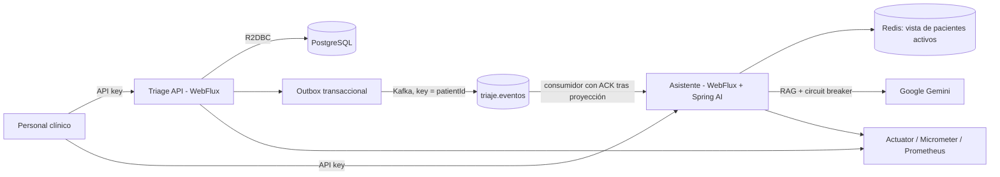

# VidaCruz - triaje digital

Implementación backend de la prueba técnica con dos aplicaciones independientes en Java 21 y Spring Boot 3.5:

- **Triage** (`:bootJar`, puerto 8080): API reactiva, reglas clínicas deterministas, R2DBC/PostgreSQL, auditoría, outbox Kafka, SLA y reportes SQL.
- **Asistente clínico** (`:assistant-service:bootJar`, puerto 8081): Spring AI/Google Gemini con recuperación del corpus, validación de citas y vista de urgencias en Redis alimentada solamente por Kafka.

> **Uso clínico:** es una implementación de referencia para la prueba, no un dispositivo médico ni un sustituto del criterio profesional. No utilizar para decisiones clínicas reales sin revisión, validación clínica, privacidad, seguridad y controles regulatorios.

## Arquitectura



Los servicios no se llaman entre sí. Triage escribe cada mutación, auditoría y evento outbox dentro de la misma transacción reactiva; un publicador asíncrono entrega el evento a Kafka. La clave Kafka es el ID del paciente para conservar el orden por paciente. La entrega puede repetirse si el publicador falla después del ACK de Kafka; la proyección Redis aplica cambios idempotentes y descarta eventos antiguos.

El asistente consume el topic `triaje.eventos`, confirma el offset solo después de actualizar Redis y calcula conteos con conjuntos por nivel. `ALTA` elimina al paciente de los conjuntos activos; `REGISTRADO` y `EN_CONSULTA` siguen activos. Para reconstruir una proyección Redis perdida, se debe conservar Redis o reiniciar el offset del grupo `clinical-assistant` para reprocesar el topic desde el inicio.

## Ejecución local

Requisitos: Docker Compose y una API key de Google AI Studio para probar consultas con coincidencias.

1. Ejecuta `make setup` para copiar `.env.example` a `.env` si todavía no existe. Edita el archivo y reemplaza `API_KEY`, `DB_PASSWORD` y `LLM_API_KEY` con una clave de Google AI Studio. Compose exige las tres variables; no se incluyen credenciales predeterminadas. El modelo por defecto es `gemini-3.8-flash`; puedes cambiarlo con `LLM_MODEL`.
2. Desde la raíz ejecuta `make up` para construir e iniciar todos los contenedores:

   ```powershell
   make up
   ```

Compose levanta PostgreSQL, Kafka (KRaft), Redis y los dos servicios en segundo plano. Spring inicializa el esquema de Triage. Usa `make down` para detenerlos, `make status` para ver su estado o `make logs` para seguir logs. `make clean-data` solicita confirmación y elimina también los volúmenes PostgreSQL y Redis.

Para comprobar endpoints, eventos, estados, auditoría, reporte y RAG sin coincidencias ejecuta `make smoke`. Para probar escalamiento con SLA crítico de un minuto, ejecuta `make up-fast-sla` y crea un paciente CRITICO en Postman; luego consulta su estado hasta ver `escalated: true`.

Las imágenes compilan con el Gradle Wrapper y ejecutan como usuario no root. Para ejecutar las pruebas sin infraestructura externa:

```powershell
.\gradlew.bat test
```

Para generar ambos JAR:

```powershell
.\gradlew.bat bootJar :assistant-service:bootJar
```

## APIs

## Pruebas manuales con Postman y Make

Importa en Postman:

- `postman/VidaCruz.postman_collection.json`
- `postman/VidaCruz Local.postman_environment.json`

Selecciona el entorno **VidaCruz Local** y asigna `apiKey` al mismo valor de `API_KEY` en `.env`. Ejecuta la colección secuencialmente: la solicitud de registro almacena automáticamente `patientId`, y las siguientes prueban auditoría, transiciones válidas/inválidas, validación, reporte, vista de urgencias y rechazo RAG cuando no hay fuente. La consulta con protocolo acepta `200` con citas verificables o `503` si el proveedor no está configurado/disponible.

La carpeta `04 - Escalamiento SLA` requiere `make up-fast-sla`: crea un paciente crítico, espera al menos un minuto y luego ejecuta la consulta de verificación para confirmar que se escaló una sola vez y se auditó.

`make manual` muestra URLs e instrucciones; `make smoke` ejecuta la comprobación HTTP automatizada equivalente para los flujos principales. `make test` ejecuta la suite Gradle; `make up-fast-sla` reinicia Triage con SLA corto para probar escalamiento.

Todos los endpoints de negocio requieren `X-API-Key`. Los endpoints de health de Actuator son públicos para las probes. En producción, usar TLS en el ingress y un gestor de secretos; la API key compartida es autenticación básica de referencia, no identidad/autorización por usuario.

### Triage (`http://localhost:8080`)

- `POST /triage/pacientes`: valida rangos y presión diastólica menor que sistólica; registra, clasifica, audita y crea evento.
- `PATCH /triage/pacientes/{id}/estado`: recibe `{"state":"EN_CONSULTA"}` o `{"state":"ALTA"}`. Transiciones no permitidas devuelven 409.
- `GET /triage/pacientes/{id}`: devuelve datos, estado, escalamiento, segundos en el estado actual y auditoría.
- `GET /triage/reportes/operacion?desde=2026-10-01T00:00:00Z&hasta=2026-11-01T00:00:00Z`: rango semiabierto `[desde,hasta)`, agrupado por hora. Promedio y p95 se calculan en PostgreSQL con `FILTER` y `percentile_cont`, no en memoria.

Ejemplo PowerShell:

```powershell
$headers = @{ "X-API-Key" = "valor-local-de-.env" }
$patient = @{
  fullName = "Paciente de prueba"; age = 45; heartRate = 130
  systolicPressure = 180; diastolicPressure = 110; oxygenSaturation = 97
  temperature = 36.8; pain = 8; gcs = 15; chiefComplaint = "Dolor torácico"
} | ConvertTo-Json
Invoke-RestMethod -Method Post -Uri http://localhost:8080/triage/pacientes `
  -Headers $headers -ContentType "application/json" -Body $patient
```

Los niveles siguen el orden de gravedad del enunciado: `CRITICO`, `URGENTE`, `URGENTE_2`, `NO_URGENTE`, `NO_URGENTE_2`. Los SLA por defecto son 5, 10, 30, 60 y 120 minutos; son configurables con `TRIAGE_SLA_*_MINUTES`. El intervalo del scheduler se configura con `TRIAGE_SCHEDULER_DELAY_MS`.

### Asistente (`http://localhost:8081`)

- `POST /asistente/consulta`: recibe `{"pregunta":"¿Cuáles son las medidas iniciales ante una crisis hipertensiva?"}` y responde `{"respuesta":"... [PROTO-001]","fuentes":[{"protocolo":"PROTO-001","seccion":"Manejo inicial"}]}`.
- `GET /asistente/estado-urgencias`: cuenta pacientes activos por nivel desde la proyección Redis; no llama a la API de Triage.

Si no hay coincidencia en `clinical-protocols.json`, devuelve exclusivamente `No existe un protocolo disponible para la pregunta.` y `fuentes: []`, sin llamar al modelo. Google Gemini se configura con una API key de Google AI Studio en `LLM_API_KEY` y opcionalmente con `LLM_MODEL` (por defecto `gemini-3.8-flash`). Sin proveedor disponible o con el circuit breaker abierto, las consultas coincidentes devuelven 503 explícito.

La respuesta generada se acepta solo si cita protocolos recuperados y el texto, al retirar las citas, aparece literalmente en la evidencia recuperada. Si no supera esa comprobación, se responde con extractos literales del corpus y sus IDs. Esta validación extractiva evita aceptar paráfrasis no verificables; no reemplaza la revisión clínica del corpus.

## Eventos, persistencia y observabilidad

Topic: `triaje.eventos`. Mensajes JSON versionados por evolución del contrato, con `eventId`, `patientId`, `type`, `level`, `state` y `occurredAt`. Tipos implementados: `paciente_registrado`, `paciente_en_consulta`, `paciente_alta`, `paciente_escalado`.

La auditoría y el outbox no tienen endpoints de borrado. El escalamiento es atómico (`REGISTRADO`, SLA vencido y `escalated=false`), de modo que tareas concurrentes no duplican auditoría/evento. La tabla outbox conserva mensajes aún pendientes; tras publicar, el consumidor Redis es idempotente por paciente/estado/fecha.

Health/readiness y probes: `/actuator/health/liveness`, `/actuator/health/readiness`. Métricas: `/actuator/metrics` y `/actuator/prometheus`; incluye `triage.classifications`, `triage.escalations`, `assistant.llm.latency` y transiciones del circuit breaker. Las APIs añaden `X-Correlation-Id` (lo aceptan o generan) y lo registran junto con método, ruta, estado y latencia, sin registrar el cuerpo clínico.

## Kubernetes / Azure

`deploy/k8s/services.yaml` contiene Deployments y Services con probes, límites de recursos y ejecución no root. Es un manifiesto base para AKS: reemplaza imágenes `YOUR_ACR`, endpoints de PostgreSQL/Kafka/Redis y crea el secreto fuera del repositorio:

```powershell
kubectl create secret generic vidacruz-secrets `
  --from-literal=api-key="$env:API_KEY" `
  --from-literal=db-user="$env:DB_USER" `
  --from-literal=db-password="$env:DB_PASSWORD" `
  --from-literal=llm-api-key="$env:LLM_API_KEY"
kubectl apply -k deploy/k8s
```

Usa Azure Database for PostgreSQL, Azure Managed Redis/servicio Redis compatible y Kafka administrado o desplegado por separado. Publica las APIs mediante ingress con TLS y restricciones de red. **No se ha desplegado en Azure en este entorno**, por lo que todavía no existe una URL pública; requiere suscripción, ACR, secretos, servicios administrados e ingress del equipo evaluador.

## Decisiones

- [ADR-001: servicios y eventos](doc/adr/001-servicios-y-eventos.md)
- [ADR-002: RAG, citas y modo degradado](doc/adr/002-rag-y-modo-degradado.md)
